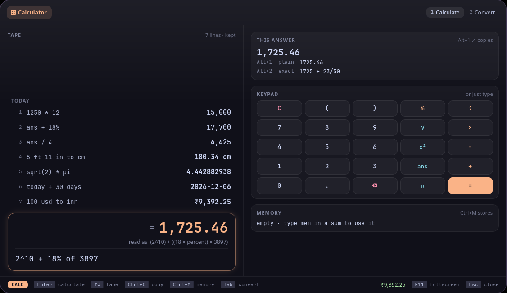

<p align="center">
  <picture>
    <source media="(prefers-color-scheme: dark)" srcset="assets/banner-dark.svg">
    <source media="(prefers-color-scheme: light)" srcset="assets/banner-light.svg">
    
  </picture>
</p>

<!-- identity -->
<p align="center">
  <b>यथा शिखा मयूराणां नागानां मणयो यथा ।<br>
  तद्वद्वेदाङ्गशास्त्राणां गणितं मूर्धनि स्थितम् ॥</b><br>
  <i>Like the crest of a peacock or the jewel of a serpent, mathematics stands at the head of the Vedāṅga sciences.</i><br>
  <sub>Vedāṅga Jyotiṣa, Yājuṣa recension 4 (the Ārca recension, v. 35, reads ज्योतिषं for गणितं)</sub>
</p>
<!-- /identity -->

<p align="center">
  <b>Calculator and converter: answers as you type (math, units, currency, percentages) through qalc, with a history.</b><br>
  The calculator and converter. A tool for <a href="https://github.com/Theyashsawarkar/vyom">Vyom</a>, keyboard-driven panels for Wayland.
</p>

<p align="center">
  <a href="https://github.com/Theyashsawarkar/ganit/actions/workflows/ci.yml"></a>
  <a href="https://github.com/Theyashsawarkar/ganit/releases"></a>
  <a href="LICENSE"></a>
  <a href="https://github.com/Theyashsawarkar/vyom"></a>
  
  
</p>

<p align="center">
  
</p>

> *Ganit* (गणित) is Sanskrit for "mathematics": the sums, conversions and currencies, answered as you type.

ganit is the calculator and converter for [Vyom](https://github.com/Theyashsawarkar/vyom): one keyboard-driven panel that opens instantly, with live data, a preview and a key for everything. It runs on any compositor with the layer-shell protocol (sway, Hyprland, river, niri, Wayfire, labwc…). In [Vayu](https://github.com/Theyashsawarkar/vayu), the desktop it was built for, it replaces wofi-calc.sh (a prompt, then a second wofi for the result).

## Contents

- [Features](#features)
- [Install](#install)
- [Usage](#usage)
- [Troubleshooting](#troubleshooting)
- [The Vyom family](#the-vyom-family)
- [Contributing](#contributing)
- [License](#license)

## Features

**Calculate** (`vyom ganit`): a calculator with a paper tape, that stays open like a real one.

- **Answers as you type**, through qalc (libqalculate): arithmetic, functions, percentages (`18% of 3897`, `3897 + 18%`), units (`5 ft 11 in to cm`), **currency** (`100 USD to INR`), dates (`today + 30 days`), bases.
- **`Enter` keeps the answer on the tape and stays open**: the box clears for the next sum, and `Esc` closes. Start a sum with an operator (`+ 100`, `× 2`) and it carries on from the last answer, like a desk calculator; `ans` is the last answer and `mem` the one saved with `m`.
- **A tape you can go back through**: the last 300 sums, grouped by day and kept between sessions. In normal mode `j`/`k` walk it, `yy` copies a line's answer, `dd` deletes one (`u` brings it back), and `Enter` (or a double-click) puts it back in the box.
- **One big answer that says how it was read**: "read as (18 × percent) × 3897", so a misread is obvious at once. Digits are grouped and money is rounded to 2 decimals (₹9,494.51).
- **The other forms beside it**: plain (for pasting), exact (a fraction, qalc's full digits), hex, binary; `Space y p`/`x`/`h`/`b` copies one.
- **A keypad you can click**, while the keyboard keeps working: the focus never leaves the box.
- **Half-typed input doesn't jump around**: while the box ends in an operator (`2 +`), the last answer stays, dimmed, "waiting for more…".

**Convert** (`vyom ganit convert`, or `L` from Calculate): a two-sided converter.

<p align="center"></p>

- **From and To, side by side**: type in either (`j`/`k` moves between them) and the other follows; `h`/`l` changes that side's unit, `Space e f` / `Space e t` picks one from the list, and `s` swaps them.
- **Every kind has its own colour**: currency, length, mass, temperature, volume, data, speed, area, time; `[`/`]` steps through them, `Space g` and a letter jumps to one.
- **The rest at a glance**: the same amount in every other unit, or every pinned currency (`Space m p` pins or unpins one); click one to make it the target.
- **`Enter` saves the conversion** to a list under it (and to the calculator's tape); the panel stays open.
- **Exchange rates you can trust**: their age is always shown, and turns yellow past two days. They update once a day in the background (not again for an hour if offline), and `Space r` updates them now.

Both: keyboard first, with vim's modes and a `Space` leader (the footer shows the keys, `?` all of them), `Space u f` (or `F11`) makes it fullscreen, and the panel never freezes: qalc runs in the background.

## Install

### Requirements

- [Vyom](https://github.com/Theyashsawarkar/vyom) 0.7 or newer (Python 3.11+, PyGObject, GTK 4, [gtk4-layer-shell](https://github.com/wmww/gtk4-layer-shell), a Nerd Font)
- `qalc`

### Install

```sh
git clone https://github.com/Theyashsawarkar/ganit ~/.local/share/vyom/plugins/ganit
vyom reload           # pick it up (or log out and in)
vyom ganit            # open it; run it again to close
```

Give it a key in your compositor, e.g. sway:

```sh
bindsym $mod+<key> exec vyom ganit
```

### Update and uninstall

```sh
git -C ~/.local/share/vyom/plugins/ganit pull && vyom reload     # update
rm -rf ~/.local/share/vyom/plugins/ganit && vyom reload          # uninstall
```

## Usage

Open it with `vyom ganit` (or your key), or straight on Convert with `vyom ganit convert`. Calculate opens in **insert mode**, so you can type a sum at once (Convert opens in normal mode, so a stray key changes nothing); `Enter` runs it and keeps it on the tape, and the panel stays open.

**Keys work like vim.** In insert mode, keys type: only `Enter` (run or save) and `Esc` (to normal mode) do something else. Every other key belongs to **normal mode**:
- `j`/`k` move and `i` goes back to typing.
- A count goes first (`5k`, `3l`).
- `Space` is the leader: after it, a strip shows what comes next (`Space t` tabs, `Space y` copy, `Space v` memory, `Space g` kind, `Space d` clear…). The letters are Vayu's shared ones: the same group means the same thing in every Vyom tool.
- `?` shows every key of the tab you're on.
- `Esc` in normal mode unpicks a tape line, then closes the panel.

Tabs: `H` / `L` (and vim's `gt` / `gT`, `Tab`), or `Space t c` / `Space t v`. Keys that moved in v0.5 say where they went for one release.

<!-- KEYS (generated by scripts/keybinds.py from ganit/vim.py) -->

Vyom's keys work too (every vim tool has them): `?` and `Space ?` list every key, `Space Space` is the palette, `H` / `L` switch tabs, `q` closes, `Space u f` is fullscreen.

**Insert mode (typing), Calculate**

| Key | Action |
|---|---|
| `Enter` | Run the sum and keep it on the tape; stays in insert mode |

**Insert mode (typing), Convert**

| Key | Action |
|---|---|
| `Enter` | Save the conversion to the list; stays in insert mode |

**Normal mode, both tabs**

| Key | Action |
|---|---|
| `i` | Enter insert mode to type (Esc goes back to normal) |
| `a` | Enter insert mode at the end of the box |

**Normal mode, Calculate**

| Key | Action |
|---|---|
| `j` | Move down the tape (a count moves further: 5j; past the end, back to the box) |
| `k` | Move up the tape (a count moves further: 5k) |
| `g g` | Jump to the first tape line |
| `G` | Jump to the last tape line |
| `Enter` | Run the sum and keep it on the tape (a picked line: put its sum in the box) |
| `=` | Run the sum and keep it on the tape |
| `y y` | Copy the answer (the picked line's, else the live one) |
| `Y` | Copy the sum with its answer (12 + 5 = 17) |
| `p` | Paste the answer at the end of the box |
| `P` | Paste the picked line's sum into the box, replacing what's there |
| `x` | Delete the last character in the box |
| `D` | Clear the box |
| `c c` | Clear the box and enter insert mode |
| `S` | Clear the box and enter insert mode |
| `d d` | Delete the picked tape line, else the last (u brings it back) |
| `u` | Undo the last deleted tape line |
| `m` | Save the answer to memory (mem in a sum uses it) |

**Normal mode, Convert**

| Key | Action |
|---|---|
| `j` | Move to the To amount |
| `k` | Move to the From amount |
| `h` | Switch this side's unit to the previous one (a count: 3h) |
| `l` | Switch this side's unit to the next one (a count: 3l) |
| `[` | Switch to the previous kind (currency, length, mass…) |
| `]` | Switch to the next kind |
| `s` | Swap From and To |
| `Enter` | Save the conversion to the list |
| `=` | Save the conversion to the list |
| `y y` | Copy the converted amount |
| `Y` | Copy the whole conversion (100 USD = 9,392.25 INR) |
| `x` | Delete the amount's last character |
| `D` | Clear the amount |
| `c c` | Clear the amount and enter insert mode |
| `S` | Clear the amount and enter insert mode |
| `d d` | Delete the newest saved conversion (u brings it back) |
| `u` | Undo the last deleted conversion |

**Leader (Space), both tabs**

| Key | Action |
|---|---|
| `Space t c` | Switch to Calculate |
| `Space t v` | Switch to Convert |
| `Space r` | Update the exchange rates now |

**Leader (Space), Calculate**

| Key | Action |
|---|---|
| `Space y y` | Copy the answer |
| `Space y e` | Copy the sum with its answer |
| `Space y p` | Copy the answer as a plain number |
| `Space y x` | Copy the exact answer (fractions, roots) |
| `Space y h` | Copy the answer in hex |
| `Space y b` | Copy the answer in binary |
| `Space v s` | Save the answer to memory |
| `Space v p` | Paste mem into the box |
| `Space v c` | Clear the memory |
| `Space d t` | Clear the whole tape (y confirms) |
| `Space d b` | Clear the box |

**Leader (Space), Convert**

| Key | Action |
|---|---|
| `Space e f` | Pick the From unit (type to filter, Enter picks) |
| `Space e t` | Pick the To unit (type to filter, Enter picks) |
| `Space y y` | Copy the converted amount |
| `Space y f` | Copy the From amount |
| `Space y l` | Copy the whole conversion |
| `Space y r` | Copy the rate (1 USD = 93.92 INR) |
| `Space m p` | Toggle the pin on the To currency (pinned ones show below) |
| `Space a a` | Save the conversion to the list |
| `Space d d` | Delete the newest saved conversion |
| `Space d a` | Clear every saved conversion (y confirms) |
| `Space g c` | Switch to currency |
| `Space g l` | Switch to length |
| `Space g m` | Switch to mass |
| `Space g t` | Switch to temperature |
| `Space g v` | Switch to volume |
| `Space g d` | Switch to data |
| `Space g s` | Switch to speed |
| `Space g a` | Switch to area |
| `Space g i` | Switch to time |

<!-- END KEYS -->

### Configuration

`[plugin.ganit]` in `~/.config/vyom/config.toml`, all optional:

| Option | Default | What it does |
|---|---|---|
| `home` | `"INR"` | Your currency: Convert starts from USD to it |
| `currencies` | `["INR", "USD", "EUR", "GBP", "AED", "JPY", "SGD"]` | The pinned currencies, until you pin or unpin one with `Space m p` |
| `start_mode` | Calculate `"insert"`, Convert `"normal"` | The mode it opens in: `"insert"` (type at once) or `"normal"` (for both tabs) |
| `grouping` | `"intl"` | Digit grouping: `"intl"` (1,234,567), `"indian"` (12,34,567) or `"none"` |

## Troubleshooting

- **Nothing opens.** `vyom list` shows every installed tool, and why one is skipped (a missing requirement, or a Vyom that's too old).
- **Currency answers are old, or Convert says it has no rate.** qalc keeps the rates in `~/.local/share/qalculate/`; the rate line in Convert shows their age. `Space r` (normal mode) updates them (it needs the network); the footer says whether it worked.
- **It opened, then something failed.** Look for a `Traceback` in the daemon's log, `journalctl --user -u vyom -u vyom-daemon -b` (without systemd: `~/.local/state/vyom/daemon.log`), and [open an issue](https://github.com/Theyashsawarkar/ganit/issues/new/choose) with it.
- **No blur or rounded corners.** That's the compositor: on SwayFX, add `layer_effects "vyom" { blur enable; corner_radius 20; shadows enable }`.

## The Vyom family

Each tool is its own repository, so you install only the ones you want:

| Tool | | What it does |
|---|---|---|
| [dvara](https://github.com/Theyashsawarkar/dvara) | द्वार, gateway | The app launcher |
| [ganit](https://github.com/Theyashsawarkar/ganit) (this one) | गणित, mathematics | The calculator and converter |
| [smriti](https://github.com/Theyashsawarkar/smriti) | स्मृति, memory | Clipboard history |
| [bhava](https://github.com/Theyashsawarkar/bhava) | भाव, feeling, emotion | The emoji picker |
| [tarang](https://github.com/Theyashsawarkar/tarang) | तरंग, wave | Wi‑Fi and the hotspot |
| [setu](https://github.com/Theyashsawarkar/setu) | सेतु, bridge | Bluetooth |
| [doot](https://github.com/Theyashsawarkar/doot) | दूत, messenger | Your phone, through KDE Connect |
| [patra](https://github.com/Theyashsawarkar/patra) | पात्र, vessel | Docker containers |
| [akashvani](https://github.com/Theyashsawarkar/akashvani) | आकाशवाणी, voice from the sky | Notifications |
| [raga](https://github.com/Theyashsawarkar/raga) | राग, melody | YouTube music and video |
| [mudra](https://github.com/Theyashsawarkar/mudra) | मुद्रा, gesture | Keybinding search |
| [urja](https://github.com/Theyashsawarkar/urja) | ऊर्जा, energy | The battery at a glance |
| [vishram](https://github.com/Theyashsawarkar/vishram) | विश्राम, rest | The power menu |
| [kendra](https://github.com/Theyashsawarkar/kendra) | केन्द्र, centre | Quick settings |

## Contributing

Bug reports, ideas and pull requests are welcome: see [CONTRIBUTING.md](CONTRIBUTING.md) for the development setup and the few rules every tool follows, and [CHANGELOG.md](CHANGELOG.md) for what changed in each release. Please report security issues privately ([SECURITY.md](SECURITY.md)).

## License

[MIT](LICENSE).
